# 00 · Bản đồ lĩnh vực và cách đọc paper

> **Chặng 0 · Bản đồ** · Paper trong bài: [V34], [V35] (xem [`research/05-danh-muc-47-paper-luan-van.md`](../research/05-danh-muc-47-paper-luan-van.md))

## 1. Mục tiêu bài

- Nắm **3 giai đoạn** của lĩnh vực AI-native SDLC để biết mỗi paper sau này "đứng ở đâu".
- Hiểu **câu định hướng luận văn** và vì sao nó nằm ở giao điểm còn ít người làm.
- Có **cách đọc một paper CS nhanh** (đọc 3 lượt) để không bị ngợp với 47 bài.
- Biết 2 survey "bản đồ" [V34], [V35] nói gì, để dùng làm khung cho chương tổng quan.

⏱️ Thời gian đọc: **~15–20 phút**.

---

## 2. Mental model: lĩnh vực này giống chuyện tuyển một "thực tập sinh AI"

Bạn đã làm phần mềm 15 năm, nên hãy hình dung một câu chuyện quen thuộc: **công ty tuyển một nhóm thực tập sinh rất nhanh tay**.

| Giai đoạn | Chuyện thực tập sinh | Chuyện trong nghiên cứu |
|---|---|---|
| **1. "Nó làm được!"** (≈2023–2024) | Giao thử ticket, thực tập sinh nộp code chạy được. Cả phòng ồ lên. | Agent LLM chứng minh **giải được GitHub issue thật** thành patch: SWE-bench, SWE-agent, AutoCodeRover, Agentless, OpenHands. |
| **2. "Khoan đã…"** (≈2024–2025) | Soi kỹ thì thấy: test họ viết dễ dãi, có bài "chép đáp án", có bài qua test nhưng sai ý khách hàng. | Phát hiện **đánh giá quá lạc quan**: test yếu, patch "plausible but wrong", dữ liệu benchmark bị nhiễm (contamination). |
| **3. "Đưa vào quy trình"** (≈2025–nay) | Không đuổi thực tập sinh, mà dựng quy trình: mentor review, checklist, CI, sổ ghi ai làm gì, quyền hạn rõ ràng. | **Đưa agent vào doanh nghiệp có kiểm soát**: review, CI gate, policy, truy vết (traceability), kiểm toán (audit). |

**Bài học của mental model:** câu hỏi đã đổi từ *"AI có viết được code không?"* sang *"Làm sao tin được thay đổi do AI tạo ra, và chứng minh điều đó với tổ chức?"*. Đây đúng là câu hỏi kiểu MIS: con người, quy trình, kiểm soát, chứ không chỉ thuật toán.

### Câu định hướng luận văn

> *"Don't use AI merely to write code faster; build a governed agentic system that turns business tickets into verified, traceable software changes."*

Tách câu này thành 4 mảnh, mỗi mảnh ứng với một cụm paper bạn sẽ đọc:

```
business tickets  →  agentic system  →  verified  →  traceable  (+ governed bao quanh)
   (yêu cầu)          (Chặng 2)        (Chặng 3–4)    (Chặng 5)    (Chặng 6–7)
```

Analogy: không phải mua một **lò nướng nhanh hơn** (AI viết code nhanh), mà xây **một bếp nhà hàng đạt chuẩn an toàn thực phẩm**: mỗi món (thay đổi) có phiếu order (ticket), có người nếm thử (verify), có nhãn truy xuất nguồn gốc (trace), và có quy định bếp (governance).

### Bản đồ 10 chặng đọc

```mermaid
flowchart LR
    C0["Chặng 0<br/>Bản đồ"] --> C1["Chặng 1<br/>Vì sao cần AI-native"]
    C1 --> C2["Chặng 2<br/>Issue → patch"]
    C2 --> C3["Chặng 3<br/>Điểm số có đáng tin?"]
    C3 --> C4["Chặng 4<br/>Kiểm chứng"]
    C4 --> C5["Chặng 5<br/>Truy vết"]
    C5 --> C6["Chặng 6<br/>Người trong vòng lặp"]
    C6 --> C7["Chặng 7<br/>Governance và an ninh"]
    C7 --> C8["Chặng 8<br/>Doanh nghiệp làm thật"]
    C8 --> C9["Chặng 9<br/>Chọn đề tài"]

    classDef g1 fill:#dbeafe,stroke:#1d4ed8;
    classDef g2 fill:#fef3c7,stroke:#b45309;
    classDef g3 fill:#dcfce7,stroke:#15803d;
    class C2 g1;
    class C3,C4 g2;
    class C5,C6,C7,C8 g3;
```



Màu xanh dương ≈ giai đoạn 1 ("nó làm được"), vàng ≈ giai đoạn 2 ("khoan đã"), xanh lá ≈ giai đoạn 3 ("đưa vào quy trình").

### Cách đọc một paper CS nhanh: đọc 3 lượt

Phương pháp của S. Keshav, ["How to Read a Paper"](https://doi.org/10.1145/1273445.1273458), ACM SIGCOMM Computer Communication Review 37(3), 2007. Analogy: **xem nhà trước khi mua**.

| Lượt | Giống như | Làm gì | Thời gian |
|---|---|---|---|
| **1. Lướt** | Đi ngang nhìn mặt tiền | Đọc tiêu đề, abstract, intro, tiêu đề các mục, kết luận; liếc hình/bảng. Trả lời: bài loại gì (hệ thống mới, benchmark, khảo sát, thực nghiệm)? Đóng góp chính là gì? | 5–10 phút |
| **2. Đọc hiểu** | Vào xem từng phòng | Đọc kỹ hình, bảng, kết quả chính; bỏ qua chứng minh/chi tiết cài đặt. Ghi lại con số quan trọng và cách họ đánh giá. | ~1 giờ |
| **3. Tái dựng** | Thuê thợ kiểm tra kết cấu | Tự hỏi "nếu mình làm lại thì sao?", tìm giả định ẩn, điểm yếu. Chỉ làm với 3–5 bài làm nền cho luận văn. | vài giờ |

Mẹo cho lộ trình này: các file `reading/` đã làm sẵn phần **lượt 1** cho bạn. Bạn chỉ cần mở bài gốc khi muốn làm lượt 2–3.

---

## 3. Thuật ngữ mới

| Thuật ngữ | Giải thích ngắn | Analogy |
|---|---|---|
| **LLM** | Mô hình ngôn ngữ lớn, sinh văn bản/code từ prompt | "Bộ não" biết nói |
| **Agent (tác tử)** | LLM + vòng lặp: lập kế hoạch → dùng công cụ → quan sát kết quả → làm tiếp | Bộ não có tay chân và trí nhớ |
| **Multi-agent (LMA)** | Nhiều agent, mỗi agent một vai, phối hợp với nhau | Một team PM / dev / QA |
| **Issue → patch** | Từ mô tả lỗi/yêu cầu, sinh ra đoạn sửa code | Từ phiếu order ra món ăn |
| **Benchmark** | Bộ bài thi chuẩn để so sánh hệ thống | Đề thi chung |
| **Survey** | Bài tổng hợp nhiều paper, phân loại thành bản đồ | Sách hướng dẫn du lịch |
| **Traceability** | Nối được yêu cầu ↔ code ↔ test ↔ thay đổi | Nhãn truy xuất nguồn gốc thực phẩm |
| **Governance** | Luật, quyền, kiểm toán quanh hệ thống | Quy định an toàn bếp |
| **Preprint** | Bài đăng arXiv, chưa qua bình duyệt | Bản nháp chưa được biên tập duyệt |

---

## 4. Hai survey làm bản đồ

### [V34] Large Language Model-Based Agents for Software Engineering: A Survey

- 🔗 https://arxiv.org/abs/2409.02977
- 👥 Junwei Liu et al. (Fudan University, NTU, UIUC) · 2024 · ACM TOSEM

**Vấn đề.** Agent LLM được dùng cho SE ngày càng nhiều, nhưng rải rác: mỗi bài một tác vụ, một kiến trúc. Thiếu một bản đồ chung.

**Ý chính.** Gom paper và phân loại theo **hai trục**, giống tấm bản đồ có kinh độ và vĩ độ:
- **Trục SE**: agent được dùng ở đâu trong vòng đời phần mềm (yêu cầu, sinh code, kiểm tra tĩnh/code review, test, debug, và end-to-end phát triển/bảo trì).
- **Trục agent**: agent được cấu tạo thế nào, gồm 4 thành phần **planning – memory – perception – action**, cộng với đa tác tử và cộng tác người–agent.

Họ phân biệt rõ: chỉ tính là "agent" khi hệ thống **lặp đi lặp lại tương tác với môi trường** và nhận phản hồi, chứ không phải gọi LLM một lần.

**Con số đáng nhớ.**
- **124 paper** được khảo sát (thu thập qua DBLP từ 01/07/2024, cộng snowballing và góp ý của tác giả).
- Khoảng **75%** tài liệu được trích dẫn là bài đã qua bình duyệt; phần còn lại là preprint arXiv.
- Có kho danh sách paper cập nhật: [FudanSELab/Agent4SE-Paper-List](https://github.com/FudanSELab/Agent4SE-Paper-List).

**Liên hệ luận văn.** Dùng 2 trục này làm **khung cho chương tổng quan (literature review)**: đặt hệ thống của bạn vào ô "end-to-end maintenance (issue → patch)" trên trục SE, và mô tả kiến trúc theo planning/memory/perception/action trên trục agent. Survey cũng nêu các điểm yếu như test chất lượng thấp làm agent "tự tin sai", và phản hồi sai gây lỗi dây chuyền. Đây là mồi cho Chặng 4 (Kiểm chứng).

### [V35] LLM-Based Multi-Agent Systems for Software Engineering: Literature Review, Vision and the Road Ahead

- 🔗 https://arxiv.org/abs/2404.04834
- 👥 Junda He, Christoph Treude, David Lo (Singapore Management University) · 2024 · ACM TOSEM (2025, số đặc biệt "SE 2030")

**Vấn đề.** Một agent đơn lẻ dễ "ảo giác" và khó gánh dự án phức tạp. Nhiều agent phối hợp (LMA) có giúp được không, và còn thiếu gì?

**Ý chính.** Ba phần:
1. **Tổng quan có hệ thống** các nghiên cứu LMA dọc SDLC: yêu cầu, sinh code, đảm bảo chất lượng, bảo trì, và phát triển end-to-end. Nhiều hệ mô phỏng quy trình **Waterfall** (MetaGPT, ChatDev) hoặc **Agile** (AgileCoder).
2. **Hai case study** với ChatDev để thấy năng lực thật.
3. **Chương trình nghiên cứu 2 pha**: (a) nâng năng lực từng agent (đóng vai SE, ngôn ngữ prompt hướng agent), (b) tối ưu phối hợp: phân việc người–agent, đánh giá sự cộng tác, mở rộng quy mô, áp dụng nguyên tắc tổ chức của doanh nghiệp, thích ứng động, bảo mật dữ liệu.

**Con số đáng nhớ.** (theo bản arXiv hiện tại)
- **71 nghiên cứu sơ cấp** (41 từ tìm kiếm DBLP + 30 từ snowballing; tìm kiếm ngày 14/11/2024).
- Case study ChatDev (GPT-3.5-turbo): game **Snake** chạy được ở **lần thử thứ 2** (~76 giây, ~0,019 USD/lần). Game **Tetris** đến **lần thứ 10** mới chơi được, nhưng **vẫn thiếu chức năng xóa hàng** (~70 giây, ~0,020 USD/lần).

**Liên hệ luận văn.** Hai điểm rất "MIS":
- Bài gợi ý đưa **nguyên tắc tổ chức của doanh nghiệp** (quản trị, quy trình, design pattern) vào hệ agent. Đó chính là góc "governed".
- Câu hỏi **"phân việc giữa người và agent thế nào"** và **"bảo mật dữ liệu khi agent chia sẻ thông tin"** vẫn để ngỏ, nên có thể thành câu hỏi nghiên cứu.

Case Tetris là ví dụ đẹp để mở đầu luận văn: *rẻ và nhanh, nhưng "chạy được" chưa có nghĩa là "đúng yêu cầu"*.

> **So sánh nhanh:** [V34] = bản đồ **rộng** (mọi agent cho SE, cả đơn lẫn đa tác tử). [V35] = bản đồ **sâu** về đa tác tử, kèm tầm nhìn tương lai. Đọc [V34] lượt 1 trước, rồi [V35] mục case study và research agenda.

---

## 5. Tự kiểm tra (3 câu)

1. Ba giai đoạn của lĩnh vực là gì? Mỗi giai đoạn trả lời câu hỏi nào?
2. Theo [V34], một hệ thống phải có đặc điểm gì mới được tính là "agent" thay vì chỉ "gọi LLM"? 4 thành phần của agent là gì?
3. Case Tetris trong [V35] cho thấy điều gì, và nó liên quan thế nào đến chữ **"verified"** trong câu định hướng luận văn?

<details>
<summary>Đáp án gợi ý</summary>

1. (1) Agent chứng minh giải được issue → "AI làm được không?"; (2) phát hiện đánh giá quá lạc quan → "điểm số có đáng tin không?"; (3) đưa agent vào doanh nghiệp có kiểm soát → "làm sao tin và quản trị được thay đổi do AI tạo?".
2. Phải lặp đi lặp lại tương tác với môi trường và hành động dựa trên phản hồi. 4 thành phần: planning, memory, perception, action.
3. Hệ thống tạo ra phần mềm "chạy được" nhưng thiếu chức năng cốt lõi (xóa hàng), tức là không có cơ chế kiểm chứng đúng yêu cầu. "Verified" nghĩa là phải có bằng chứng thay đổi khớp với ticket, không chỉ là chạy được.

</details>

---

## 6. Bài tiếp theo

➡️ **`01-se-3-0-va-agentic-se.md`** (Chặng 1): tầm nhìn **SE 3.0** [V36] và **Agentic Software Engineering** [V37], nơi xuất hiện khái niệm **Merge-Readiness Pack**, gần như trùng ý "thay đổi đã kiểm chứng, truy vết được" của luận văn.
