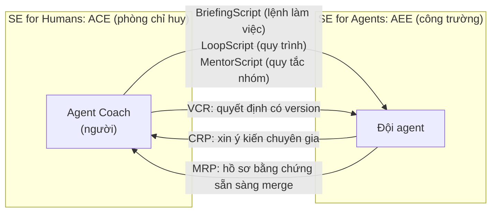

# 01 · SE 3.0 và Agentic Software Engineering

> **Chặng 1 · Vì sao cần AI-native** · Paper trong bài: [V36], [V37] (xem [`research/05-danh-muc-47-paper-luan-van.md`](../research/05-danh-muc-47-paper-luan-van.md))

## 1. Mục tiêu bài

- Phân biệt được **SE 1.0 / 2.0 / 3.0**, và hiểu vì sao "AI-native" khác với "AI-assisted".
- Nắm bộ từ vựng của SASE (Structured Agentic Software Engineering): **SE for Humans vs SE for Agents**, **ACE / AEE**, và các artefact như **BriefingScript, MentorScript, LoopScript, CRP, MRP, VCR**.
- Thấy rõ vì sao **Merge-Readiness Pack (MRP)** gần như là bản mô tả hướng luận văn của bạn, và vì sao nó vẫn là **khoảng trống** cần làm.

⏱️ Thời gian đọc: **~15–20 phút**.

---

## 2. Mental model: từ "thợ cả + máy khoan" đến "chỉ huy công trường"

Hãy hình dung việc xây nhà qua ba thời kỳ:

| Thời kỳ | Chuyện xây nhà | Chuyện làm phần mềm (theo [V36]) |
|---|---|---|
| **SE 1.0** | Thợ cả tự làm hết bằng dụng cụ cầm tay. | **Code-centric**: con người dịch yêu cầu thành code, dùng IDE, công cụ test, công cụ phân tích. Người là trung tâm. |
| **SE 2.0** | Thợ cả có thêm máy khoan, máy cưa điện. Nhanh hơn, nhưng vẫn phải tự cầm máy từng mũi khoan. | **AI-assisted**: Copilot, Claude Code, Cursor… giúp viết, test, debug. Người vẫn **cầm vòng lặp viết code**, nên bị **quá tải nhận thức** (chia nhỏ việc, viết prompt, soát gợi ý, sửa lỗi…). |
| **SE 3.0** | Thợ cả thành **chỉ huy công trường**: nói rõ mình muốn gì, đội thợ làm, chỉ huy nghiệm thu bằng biên bản. | **AI-native**: phát triển xoay quanh **ý định (intent)** qua **hội thoại** giữa người và "AI teammate". AI cầm vòng lặp tạo code, còn người lo ý định, chiến lược và nghiệm thu. |

[V36] vẽ tầm nhìn SE 3.0. [V37] đi tiếp một bước: nếu người thành "chỉ huy công trường" thì cần **phòng chỉ huy**, **công trường riêng cho thợ**, và **giấy tờ chuẩn** (lệnh làm việc, phiếu hỏi ý kiến, biên bản nghiệm thu). Nếu thiếu giấy tờ, công trình nhanh nhưng **không ai dám ký nhận**.

### Sơ đồ: hai "workbench" và các giấy tờ đi lại giữa chúng (theo [V37])

**Ý chính cần nhớ:** ở SE 3.0, thứ tạo nên **niềm tin** không phải là code chạy được, mà là **bằng chứng có cấu trúc, truy vết được và kiểm toán được** đi kèm thay đổi.

---

## 3. Thuật ngữ mới

| Thuật ngữ | Giải thích ngắn | Analogy |
|---|---|---|
| **AI-assisted vs AI-native** | AI hỗ trợ quy trình cũ, so với quy trình được thiết kế lại với AI ở trung tâm | Gắn máy vào xe ngựa, so với thiết kế ô tô |
| **Intent (ý định)** | Kết quả hay mục tiêu người muốn đạt ([V36]) | "Tôi cần nhà 3 phòng ngủ hướng Nam" |
| **Conversation-oriented development** | Làm rõ ý định qua hội thoại qua lại với AI teammate | Trao đổi với kiến trúc sư nhiều vòng |
| **AI teammate** | AI là đồng đội học được và chủ động, không chỉ là công cụ thụ động | Đồng nghiệp, khác với cái máy khoan |
| **SE4H / SE4A** | SE for Humans / SE for Agents: hai "mặt" của ngành trong thời agent ([V37]) | Phòng chỉ huy và công trường |
| **ACE** | Agent Command Environment: bàn làm việc của người để giao việc, điều phối và duyệt bằng chứng | Phòng chỉ huy |
| **AEE** | Agent Execution Environment: môi trường tối ưu cho agent thực thi | Công trường có máy móc chuyên dụng |
| **BriefingScript** | Lệnh làm việc có cấu trúc: phạm vi, tiêu chí thành công, ngữ cảnh kiến trúc, lời khuyên, "bẫy" cần tránh | Lệnh sản xuất kèm bản vẽ |
| **LoopScript** | Quy trình khai báo: chia việc, chạy song song, điểm review, mức độ chặt chẽ | Quy trình thi công (SOP) |
| **MentorScript** | Bộ quy tắc của nhóm dạng code ("mentorship-as-code") | Sổ tay nội quy công trường |
| **CRP** | Consultation Request Pack: agent chủ động hỏi chuyên gia khi gặp mơ hồ hoặc trade-off | Phiếu xin ý kiến kỹ sư kết cấu |
| **MRP** | Merge-Readiness Pack: gói bằng chứng chứng minh thay đổi đủ chuẩn để merge | Hồ sơ nghiệm thu công trình |
| **VCR** | Version Controlled Resolution: phản hồi của người cho từng CRP/MRP, có version và liên kết | Biên bản ký duyệt |

---

## 4. Từng paper

### [V36] Towards AI-Native Software Engineering (SE 3.0): A Vision and a Challenge Roadmap

- 🔗 https://arxiv.org/abs/2410.06107
- 👥 Ahmed E. Hassan (Queen's University), Gustavo A. Oliva, Dayi Lin, Boyuan Chen (Huawei Canada), Zhen Ming (Jack) Jiang (York University) · 2024 · ACM TOSEM (2026)

**Vấn đề.** SE 2.0 (AI coding assistant) có ích nhưng có giới hạn gốc rễ:
- **Quá tải nhận thức**: người vẫn phải chia nhỏ việc, viết prompt, soát gợi ý, debug, rồi lặp lại.
- **Huấn luyện model kém hiệu quả**: dựa vào dữ liệu internet thô, tốn kém, suy luận nông.
- **Thiên lệch "thêm code"**: trợ lý hay gợi ý thêm code thay vì refactor, khiến codebase phình to và khó bảo trì. Code do AI sinh lại "nhiễm" ngược vào dữ liệu huấn luyện tương lai.

**Ý chính.** Chuyển sang **SE 3.0, tức AI-native**: phát triển **lấy ý định làm trung tâm (intent-centric)** và **hướng hội thoại (conversation-oriented)**. Người và AI teammate cùng làm rõ ý định, sau đó AI cầm vòng lặp tạo code. Theo tác giả, code chỉ là phương tiện. Tầm nhìn đi kèm một **technology stack**:

| Thành phần | Vai trò |
|---|---|
| **Teammate.next** | AI teammate cá nhân hóa, tự học, kiêm mentor lập trình 1-1 |
| **IDE.next** | IDE xoay quanh ý định: căn chỉnh ý định qua hội thoại, code ẩn mặc định, có chế độ debug cấp thấp. Hội thoại trở thành tài sản cần được quản lý version. |
| **Compiler.next** | Tổng hợp code từ ý định bằng **tìm kiếm đa mục tiêu** (độ chính xác, độ trễ, chi phí). Có cơ chế **goal-tracking**: test phải được sinh **từ ý định/yêu cầu**, không phải từ code có sẵn. |
| **Runtime.next** | Runtime nhận biết SLA, gom các hoạt động vào chung cụm (uni-cluster), mở rộng xuống edge (model nhỏ chạy cục bộ) |
| **FM.next** | Foundation model huấn luyện theo **giáo trình (curriculum engineering)** về SE, thay vì "cào" dữ liệu đại trà |

Bài nêu 5 thách thức chính: tăng tốc căn chỉnh ý định giữa người và AI, tổng hợp code hiệu quả, hiệu năng runtime, giúp model hiểu sâu code/SE, và loại bỏ nhu cầu prompt engineering. Ngoài ra có một loạt câu hỏi mở (OQ7–OQ14), ví dụ: kỹ sư giỏi thời SE 3.0 là người thế nào, và AI teammate đã cá nhân hóa thì thuộc về công ty hay cá nhân.

**Con số/điểm đáng nhớ.**
- Bài chỉ ra giới hạn của SWE-bench: **chỉ Python, chỉ 12 project, ~70% task đến từ 3 trong 12 project**. Vì vậy hiệu năng thực tế của các "kỹ sư phần mềm tự động" vẫn chưa rõ. (Bạn sẽ gặp lại ở Chặng 3.)
- Lập luận "con người là nút thắt, không phải AI": con người không thể diễn đạt trọn ý định trong một lần, nên dù model mạnh đến đâu thì việc căn chỉnh ý định vẫn chậm.
- Câu kết trích Kasparov: *người chơi yếu + máy + **quy trình tốt hơn*** thắng *người mạnh + máy + quy trình kém*. Quy trình là đòn bẩy.

**Liên hệ luận văn.**
- Đây là nguồn của thuật ngữ **"AI-native SE"** để dùng trong tiêu đề và chương lý thuyết.
- Ý "**test phải sinh từ ý định, không từ code**" của Compiler.next chính là tiền đề cho truy vết **ticket → tiêu chí chấp nhận → test** (Chặng 4–5).
- Ý "**hội thoại là tài sản cần quản lý version**" gắn trực tiếp với audit/provenance (Chặng 7).

### [V37] Agentic Software Engineering: Foundational Pillars and a Research Roadmap

- 🔗 https://arxiv.org/abs/2509.06216
- 👥 Ahmed E. Hassan, Hao Li, Dayi Lin, Bram Adams (Queen's University), Tse-Hsun Chen (Concordia), Yutaro Kashiwa (NAIST), Dong Qiu (Huawei Canada) · 2025 · **arXiv preprint**

**Vấn đề.** Coding agent (Jules, Codex, Claude Code, Devin…) đã tạo ra hàng trăm nghìn PR được merge, nhưng có **khoảng cách "tốc độ vs niềm tin"**: nhiều PR chưa thật sự "merge-ready" (regression tinh vi, sửa bề mặt, vệ sinh kỹ thuật kém). Ở quy mô agent, khối lượng review có thể **nhấn chìm** developer. Cách làm hiện nay, chủ yếu là chat và prompt không chính thức, **không tạo ra được quy trình tái lập, artefact kiểm toán được, hay cơ chế hợp tác bền vững**.

**Ý chính.** Tầm nhìn **SASE (Structured Agentic Software Engineering)**:

1. **Tính hai mặt (duality)**: **SE for Humans** (người thành "Agent Coach": ý định, chiến lược, mentor) và **SE for Agents** (môi trường có cấu trúc để nhiều agent làm việc hiệu quả).
2. **Bốn trụ cột** cần nghĩ lại: **Actors** (người + agent), **Processes** (hoạt động có cấu trúc thay cho prompt tùy hứng), **Tools** (hai workbench **ACE** và **AEE** thay cho IDE all-in-one), **Artifacts** (artefact bền, máy đọc được, có version, thay cho prompt dùng xong bỏ).
3. **Artefact**: người gửi **BriefingScript, LoopScript, MentorScript**. Agent gửi lại **CRP** (xin ý kiến) và **MRP** (bằng chứng sẵn sàng merge). Người phản hồi bằng **VCR**.
4. **Các hoạt động kỹ thuật (engineering activities)**: Briefing Engineering, Agentic Loop Engineering (ALE), AI Teammate Mentorship Engineering (ATME), Agentic Guidance Engineering (AGE), AI Teammate Lifecycle & Infrastructure Engineering (ATLE & ATIE).
5. **Thang tự động hóa 0–5**, mượn từ cấp độ xe tự lái SAE: Level 2 "Task-Agentic" ≈ SE 2.0 (Copilot), Level 3 "Goal-Agentic" ≈ SE 3.0 (Devin, Claude Code, Jules, Codex nhắm tới). Level 4–5 là tự chủ theo miền và tổng quát.
6. Phân biệt **agentic coding** (1 người với 1 trợ lý) và **agentic software engineering** (N người với N agent, có governance, review dựa trên bằng chứng, tham vấn liên vai trò).

**MRP: 5 tiêu chí bằng chứng** (đây là phần quan trọng nhất cho bạn):

| # | Tiêu chí | Bằng chứng trong gói |
|---|---|---|
| 1 | **Functional Completeness** | Chứng minh (ví dụ test end-to-end) rằng tính năng đầy đủ và đúng như đặc tả |
| 2 | **Sound Verification** | Không chỉ log test pass, mà cả **test plan** và **test mới** agent viết |
| 3 | **Exemplary SE Hygiene** | Báo cáo static analysis, lint, độ phức tạp |
| 4 | **Clear Rationale and Communication** | Tóm tắt dễ đọc về cách tiếp cận và trade-off |
| 5 | **Full Auditability** | Dấu vết "đóng băng": link có version tới BriefingScript/MentorScript, công cụ và trajectory của agent, để tái lập được |

MRP phải hỗ trợ **"progressive disclosure"**: người review xem tóm tắt trước, rồi đào sâu vào log test hay trace khi cần.

**Con số/điểm đáng nhớ.** (theo bản arXiv hiện tại, các số do bài trích từ nghiên cứu khác)
- **29,6%** bản sửa "plausible" trên SWE-bench gây regression hoặc sai khi kiểm tra lại kỹ. (Bạn sẽ đọc bài gốc ở Chặng 4.)
- Tỉ lệ giải đúng thật của patch GPT-4 giảm từ **12,47% xuống 3,97%** sau khi audit thủ công.
- Dataset AIDev: **932.791 PR do agent tạo** trên **116.211 repo** (mốc dữ liệu 01/08/2025).
- Ví dụ minh họa: một developer bỏ **~1,5 giờ** viết đặc tả cho **7 ticket**, agent sinh **28 PR song song** (4 PR mỗi ticket, kiểu N-version programming), rồi người chọn bản tốt nhất.

**Liên hệ luận văn.**
- **MRP ≈ "verified, traceable software changes".** Tiêu chí 1–2 là **verified**, tiêu chí 5 là **traceable/auditable**, và BriefingScript là phiên bản có cấu trúc của **business ticket**. Câu định hướng của bạn gần như là "hiện thực hóa BriefingScript → agent → MRP → VCR".
- **Đây là khoảng trống (KT3):** chính tác giả nói SASE là **tầm nhìn có chủ đích**, một "khung khái niệm" để mở cuộc thảo luận, **không đưa ra giải pháp hoàn chỉnh**. Bài **chưa hiện thực hóa MRP và chưa đánh giá thực nghiệm**. Phần roadmap còn nêu rõ cần **chuẩn cho "bằng chứng đủ"** của MRP, và cần **truy vết từ code/bằng chứng ngược về từng điều khoản của brief**.
- Một luận văn MIS có thể: thiết kế schema MRP tối thiểu, sinh MRP tự động từ pipeline agent (ví dụ trên nền Agentless/OpenHands), rồi đo xem MRP có giúp người review quyết định nhanh hơn và đúng hơn không. Đó là design science có artefact và có đánh giá.

> **So sánh nhanh:** [V36] trả lời *"SE sẽ thành gì?"* (tầm nhìn và tech stack). [V37] trả lời *"Làm sao để tin và quản trị được agent?"* (quy trình, workbench, artefact). Với hướng "governed", **[V37] là bài định vị chính**, còn [V36] cung cấp thuật ngữ nền.

---

## 5. Tự kiểm tra (3 câu)

1. SE 2.0 và SE 3.0 khác nhau ở điểm cốt lõi nào: ai "cầm" vòng lặp tạo code, và trung tâm của phát triển là gì?
2. Trong SASE, CRP và MRP khác nhau thế nào? Ai tạo ra chúng, và người phản hồi bằng artefact gì?
3. Vì sao nói MRP vừa là "bản mô tả" hướng luận văn, vừa là một khoảng trống nghiên cứu?

Đáp án gợi ý

1. SE 2.0: người cầm vòng lặp, trung tâm là code (task-driven, code-centric), AI chỉ hỗ trợ. SE 3.0: AI cầm vòng lặp tạo code, trung tâm là ý định được làm rõ qua hội thoại (intent-centric, conversation-oriented).
2. Cả hai đều do agent tạo. CRP là yêu cầu xin ý kiến người khi gặp mơ hồ hoặc trade-off, giữa chừng công việc. MRP là gói bằng chứng nộp khi xong việc, chứng minh đủ chuẩn để merge. Người phản hồi bằng VCR (Version Controlled Resolution), có liên kết tới CRP/MRP tương ứng.
3. MRP đòi bằng chứng về tính đầy đủ, kiểm chứng, vệ sinh kỹ thuật, lý do và khả năng kiểm toán, tức đúng "verified + traceable". Nhưng [V37] chỉ đề xuất ở mức tầm nhìn: chưa có hiện thực, chưa có chuẩn "bằng chứng đủ", chưa có đánh giá. Hiện thực hóa và đánh giá MRP chính là KT3.

---

## 6. Bài tiếp theo

➡️ **`02-ai-khong-chi-de-code-nhanh.md`** (Chặng 1): RCT của METR, nơi developer có kinh nghiệm dùng AI lại **chậm hơn** [V47], và các nút thắt của AI4SE [V38]. Bằng chứng thực nghiệm cho câu "đừng chỉ dùng AI để code nhanh hơn".
