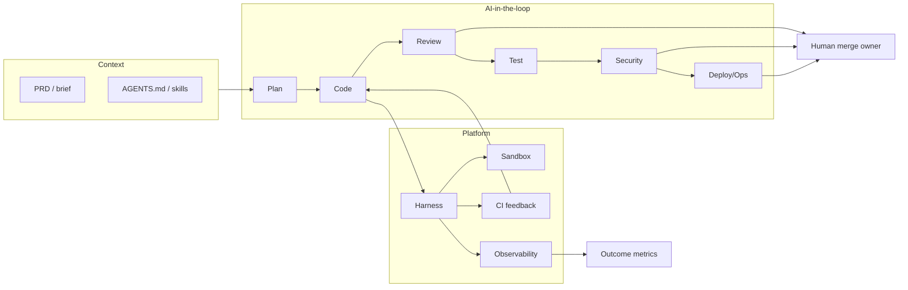

# Playbook AI Native SDLC

**Đối tượng:** Engineering leaders / staff engineers muốn áp dụng AI Native SDLC.  
**Không phải:** pitch vendor.  
**Ngày tổng hợp:** 2026-09-12  
**Nguồn gốc:** `/workspace/ai-native-sdlc-case-studies.md`, `/workspace/shopify-river-dispatch-deepdive.md` (+ cite eng-blog đã ghi trong đó).  
**Quy ước:** Số liệu chỉ lấy từ nguồn đã nêu; số từ Coinbase/Cursor, Booking/DX, FPT/Microsoft News mang caveat marketing-heavy.

---

## 0. Cách dùng playbook này

| Bạn cần… | Đọc mục |
|----------|---------|
| Hiểu “AI Native” khác Copilot thế nào | §1 + §2 |
| Map AI vào Plan→Ops của team mình | §3 |
| Xây nền tảng (harness, sandbox, skills) | §4 |
| Chọn KPI không sai | §5 |
| Lộ trình 90 ngày | §6 |
| Checklist theo quy mô | §7 |
| Tránh lỗi đã thấy ở các công ty | §8 |
| One-pager cho leadership | §9 |
| **Bắt đầu thứ Hai** (đã có Copilot/Cursor, chưa có harness) | cuối §0 + §6 Phase 0–1 |

### Start Monday — 5 việc cụ thể (Copilot/Cursor hôm nay, chưa có harness)

1. **Viết `AGENTS.md` tối thiểu** cho 1 service quan trọng: lệnh chạy test/lint, boundaries, “không được làm gì”, 2–3 ví dụ PR tốt. Sống cùng repo, review như code. (Shopify: skills/`AGENTS.md` = living memory; Stripe: agent rule files theo subdirectory.)
2. **Chọn 1 friction có metric** — không “áp AI toàn bộ”. Ví dụ: migration lặp (Spotify Fleet), review overload (Uber uReview), privacy/compliance checklist (WhatsApp), hoặc dependency vuln backlog (Shopify River remediation).
3. **Bật feedback sớm trong vòng agent**: lint local < phút + CI selective trên PR agent tạo; tối đa 1–2 vòng autofix trước khi ping human. (Stripe Minions: lint <5s, tối đa 2 vòng CI.)
4. **Định nghĩa accountability**: mọi PR agent-generated vẫn cần human merge owner; comment AI phải có rating/accept path. (Grab, Stripe, WhatsApp; Uber: usefulness > volume.)
5. **Đo baseline tuần 0**: time idea→first PR / →merge, % PR merge, build success, % AI review comment được address — *không* đo LOC. (Coinbase nhấn time-to-production; Accenture RCT đo PR/merge/build.)

---

## 1. Định nghĩa vận hành (1 trang ngắn)

**AI Native SDLC** = thiết kế lại vòng đời phần mềm để AI (copilot, coding agent, review agent, test/security agent) tham gia **có kiểm soát** ở plan → code → review → test → security → deploy/ops — không chỉ gắn autocomplete vào IDE.

Đội thành công thường làm bốn việc cùng lúc:

1. **Context cho agent** — specs, PRD/tech requirements, `AGENTS.md`, skills, rule files có điều kiện (Coinbase Plan Mode; Shopify skills; Stripe subdirectory rules).
2. **Chạy trong harness/sandbox gắn CI** — agent loop tách khỏi nơi chạy code; lint/CI/test làm oracle (Stripe Minions, Shopify Aquifer/Dispatch, Spotify Honk).
3. **Human accountability ở merge/production** — agent đề xuất; người chịu trách nhiệm ship (Grab CTO; Stripe human review; WhatsApp one-click hoặc commandeer-revise).
4. **Đo outcome** — time-to-production, PR merge, usefulness của review, maturity — không vanity LOC (Coinbase; Uber; Salesforce maturity curve).

**Bottleneck mới:** khi code rẻ, khan là **review, verification, harness, governance** (Grab; Uber lý do xây uReview; Shopify: “noise worse than no finding”).

> “Code is going to be increasingly written with AI, and our infrastructure needs to be the substrate for that.” — Shopify early-2024 bet ([Under the River](https://shopify.engineering/under-the-river))

> “The models are getting better, but the most important piece of the system remains the harness.” — Shopify Dispatch

---

## 2. Nguyên tắc bất biến (10 principles)

Mỗi principle: **1 câu** · **vì sao (+ cite)** · **anti-pattern**

| # | Principle | Vì sao (cite) | Anti-pattern |
|---|-----------|---------------|--------------|
| 1 | **Harness sống lâu hơn model** — đầu tư orchestration, sandbox, tools, oracle; model swap được. | Shopify Dispatch; Spotify pluggable CLI; Salesforce build harness đổi model | Nhét vendor model mới mỗi quý mà không có loop/CI/skills |
| 2 | **Decouple brain from hands** — agent loop (keys, decision log) ngoài sandbox chạy code. | Shopify Aquifer; Anthropic quote trong Under the River | Agent + `rm -rf` cùng blast radius; không log quyết định |
| 3 | **Agent-friendly ≈ human-friendly** — monorepo/legibility, env reproducible, CI sạch, docs viết xuống. | Shopify World+Nix; Stripe “If it’s good for humans, it’s good for LLMs.” | Repo phân mảnh + env bespoke rồi trách agent “không hiểu codebase” |
| 4 | **Skills / `AGENTS.md` là trí nhớ sống** — feed pattern từ session/FP vào file trong repo, không chỉ upgrade model. | Shopify River; Stripe conditional rules; Microsoft experiment: spec/context | Prompt one-off trong chat riêng; không diff được |
| 5 | **Feedback gắn CI, shift-left** — lint nhanh + selective CI + tối đa N vòng autofix. | Stripe Minions (lint <5s, ≤2 CI); Uber AI reviewer median 4 phút | Agent mở PR “mù” chờ human mới chạy test |
| 6 | **Precision / trust trước volume** — lọc noise; test-as-oracle; post-process. | Uber usefulness >75%, tránh nit style; Shopify audit >30 candidates → 0 giữ mức cao sau verify | Spam comment/finding → mất trust AppSec/review |
| 7 | **Human owns merge & production** — agent parallelize attention; người chịu trách nhiệm. | Grab; Stripe human-reviewed minion PRs; WhatsApp graduated autonomy | “AI đã viết nên merge luôn”; reviewer noop / đổ hết liability |
| 8 | **Đo outcome, không LOC / vanity adoption** | Coinbase: idea→prod; Uber usefulness; Salesforce Effective Output + maturity; Accenture PR/merge/build | Chỉ % license dùng hoặc dòng code AI generate |
| 9 | **Bắt đầu chỗ friction cao có metric** | WhatsApp privacy 15%→53%; Spotify Fleet migrations 60–90% time; Uber review scale ~65k diffs/tuần | “Rollout Copilot toàn công ty” không use-case neo |
| 10 | **Enablement có chủ đích + redesign quy trình** | Coinbase: không nhét AI vào hệ cũ; Booking: workshop/DX mới tăng usage; Salesforce pilot phản ánh độ phức tạp thật | Phát license rồi chờ phép màu; vibe coding không architecture (Travelopia/Equal Experts cảnh báo) |
| 11 | **Prompt ≠ control plane** — rule đóng vuln/merge/cred phải enforce bằng code deterministic. | Shopify remediation: “A workflow prompt isn't a control plane”; Dispatch: Git/creds/storage thuộc scripts | Tin agent “sẽ nhớ” pagination, dedup, head identity |
| 12 | **Multiplayer / shared transcript khi muốn compound learning** | Shopify: public Slack only; Tobi — private window = chỉ 1 người học | Agent chỉ trong DM/laptop riêng mãi mãi (ceiling tổ chức) |

---

## 3. Map theo giai đoạn SDLC

### Plan

| | |
|--|--|
| **AI làm** | Draft PRD/tech requirements; Plan Mode; hỏi/đẩy lại plan xấu; map privacy→verification (RAG); architecture notes tái dùng. |
| **Human giữ** | Mục tiêu sản phẩm, risk, tradeoff, ưu tiên; approve hướng trước khi agent code lớn. |
| **Ví dụ** | Coinbase: viết requirements cho agent, bỏ phụ thuộc sprint cứng (**marketing-heavy** số liệu). Shopify River: push back plan xấu trên Slack. WhatsApp: privacy requirements → verification. Dispatch: architecture documentation stage. |
| **Starter (small/mid)** | Template “agent brief” 1 trang (goal, constraints, test commands, out-of-scope) + `AGENTS.md` zone; review brief như review design doc ngắn. |

### Code

| | |
|--|--|
| **AI làm** | Autocomplete / agent tạo PR; migration/ad-hoc; multi-agent song song; one-shot trên devbox giống máy eng. |
| **Human giữ** | Architecture boundaries; chọn task đưa agent; ownership PR; không “vibe” không spec. |
| **Ví dụ** | Spotify Honk: >1,500 agent PR merge; migration phức tạp tiết kiệm 60–90% thời gian. Stripe: >1,000 PR/tuần minion (human-reviewed). Shopify: 1/8 merged PR River-coauthored; 3,536 PR coauthored / 30 ngày. Accenture×Copilot RCT: +8.69% PR/dev, +15% merge rate. Coinbase (vendor): 75% PR agent — **caveat**. Grab (journalism): ~90% eng dùng AI hàng ngày; MR/person ~+40%. |
| **Starter** | 1 workflow: “agent mở PR từ ticket + `AGENTS.md`”; cấm merge nếu lint/CI đỏ; cap số agent song song theo khả năng review. |

### Review

| | |
|--|--|
| **AI làm** | Reviewer thứ hai; LLM-as-judge; confidence filter, dedupe, suppress category; Fixer đề xuất patch từ comment. |
| **Human giữ** | Merge authority; quyết định product/intent; rating usefulness. |
| **Ví dụ** | Uber uReview: >90% của ~65k diffs/tuần; usefulness >75%; >65% comment được address; ~1,500 giờ tiết kiệm/tuần; median 4 phút. Spotify: LLM-as-judge trên diff. WhatsApp: one-click 60% / commandeer-revise 40%. |
| **Starter** | Bật AI review trên PR đủ điều kiện với **suppress style-nit**; bắt buộc thumbs up/down trên comment; đo % address trước khi mở rộng. |

### Test

| | |
|--|--|
| **AI làm** | Chạy test trong session; author test chứng minh finding; autofix lint; selective CI. |
| **Human giữ** | Chiến lược test, flaky budget, định nghĩa “done” trên default branch. |
| **Ví dụ** | Stripe: selective CI trên >3M tests, ≤2 vòng. Shopify Dispatch: test bootstrap + verifier author/execute tests = oracle. Accenture: +84% successful builds (RCT). |
| **Starter** | Document “how to run tests” trong `AGENTS.md`; agent không được mở PR nếu chưa chạy subset bắt buộc local. |

### Security

| | |
|--|--|
| **AI làm** | Hunt theo partition; verify adversarial (model khác); score/dedup; draft fix PR; remediation loop (rebase, revalidate HEAD). |
| **Human giữ** | Severity product/risk; merge security; quyết drop patch khi sai intent. |
| **Ví dụ** | Shopify Dispatch: >80 apps; >300 findings / ~6 tuần; bug-bounty equiv. >$400k; full scan $50–300, diff ~$5–50. River remediation: backlog open ↓ ~70% / 11 ngày; security merges freshness-gated ~10%→~80%. WhatsApp: privacy coverage 15%→53%. Uber AppSec assistant trong uReview. |
| **Starter** | Hunt ≠ ping eng: bắt buộc verifier + test proof; diff-scan sau baseline; “done” = default branch + tracker, không chỉ CI green trên PR mở. |

### Deploy / Ops

| | |
|--|--|
| **AI làm** | Query warehouse/traces; bug triage; incident assist; fleet transform; xác nhận closure trên head. |
| **Human giữ** | Production change approval; on-call accountability; rollback decision. |
| **Ví dụ** | Shopify River: warehouse + production traces; closure = head + tracker + ledger. WhatsApp: bug triage precision ~86–90% high-priority; root-cause ~21% outages. Spotify Fleet: ~½ PR từ hệ thống tự động (Fleetshift) từ mid-2024. |
| **Starter** | Agent chỉ **đề xuất** runbook/triage trong channel on-call; mọi prod action qua quy trình hiện có + human ACK. |

---

## 4. Lớp nền tảng (platform layers)

| Lớp | Việc cần có | Minh chứng | Starter tối thiểu |
|-----|-------------|------------|-------------------|
| **Harness** | Agent loop, tool intents, profile (prompt+skills+policy+model defaults), đổi model được | Shopify Aquifer; Spotify CLI; Stripe goose+Toolshed; Salesforce orchestration | Script/CLI bọc 1 agent + log; 1 profile trước |
| **Sandbox** | Filesystem/shell/repo tách blast radius; disposable; đôi khi warm | Aquifer sandbox ≠ harness; Stripe “devbox” giống máy eng | Container/VM/devcontainer; không chạy agent tool trên laptop prod secrets |
| **Skills / `AGENTS.md`** | Knowledge dạng file trong repo; load on demand; diff/review | Shopify World intelligence layer; Stripe subdirectory rules | 1 file `AGENTS.md` + 2 skills (test, PR template) |
| **CI feedback** | Lint nhanh, selective CI, N vòng autofix, AI review in loop | Stripe ≤2 CI; Uber 4 phút; Spotify MCP format/lint | Gate PR agent: lint + unit; fail → agent 1 vòng rồi stop |
| **Observability** | Session/event log, traces, cost/token, feedback ratings | Shopify Postgres session log; Spotify GCP+MLflow; Uber Kafka→Hive; Salesforce token discipline | Append-only log mỗi session + dashboard token/$ tuần |
| **Accountability** | Human merge owner; creds/Git/storage deterministic; handoff có evidence + 1 câu hỏi | Grab; Stripe; Shopify remediation; WhatsApp ownership science | CODEOWNERS + bắt buộc human approve; secrets không trong prompt agent |

Ba mode consumer cùng substrate (Shopify): **Interactive** (chat) · **Automation** (PR review) · **Job** (CI/batch). Team nhỏ: chọn **một** mode trước.

---

## 5. Metric đúng / metric sai

### Metric đúng (có precedent)

| Metric | Ai dùng / nói | Ghi chú |
|--------|----------------|---------|
| Time idea → first PR / → production | Coinbase (vendor case: 8 ngày→<30 phút; 20 ngày→<2 ngày — **caveat**) | Đo lead time, không LOC |
| PR / engineer, merge rate, successful builds | Accenture×Copilot RCT: +8.69% PR/dev; +15% merge; +84% builds | Có xung đột lợi ích GitHub nhưng RCT |
| % PR / diffs AI touch + **usefulness** | Uber: usefulness >75%; >65% comment address; Spotify >1,500 merged agent PRs; Stripe >1k PR/tuần minion; Shopify 1/8 PR River | Volume không đủ |
| Work items / PR merged / “Effective Output” | Salesforce: +90.5% work items/dev; +88.1% PR merged/dev; EO +200.3% (**mixed** advocacy) | Kèm maturity curve |
| Trust / noise: % findings có test proof; FP rate tới eng | Shopify Dispatch (noise worse than silence); Uber precision | AppSec & review |
| Closure thật: default branch + tracker | Shopify remediation (~70% backlog↓; freshness-gated merges ~10%→~80%) | CI green trên PR mở ≠ fixed |
| Cost: $/scan, token spend, compaction | Dispatch $50–300 full / $5–50 diff; Salesforce auto-compaction −24.8% spend; smart defaults tiết kiệm $864k tuần đầu (**theo bài SF**) | Guardrail chi phí |
| Adoption có chiều sâu | Booking daily users + throughput (**marketing-heavy**); Grab ~90% daily (journalism); FPT survey retention (**marketing**) | Dùng kèm outcome |
| Compliance coverage | WhatsApp privacy 15%→53% | Friction cao → trust |

### Metric sai / vanity

| Tránh | Lý do |
|-------|-------|
| LOC / % code “do AI viết” làm KPI chính | Coinbase cố ý tránh; Salesforce dùng Effective Output thay vì thuần volume |
| Số license / “đã bật Copilot” | Booking: tool sẵn nhưng usage thấp đến khi enablement |
| Số comment AI / số finding không lọc | Uber/Shopify: phá trust |
| “100% vibe coding” không architecture gate | Travelopia/Equal Experts; Microsoft experiment: vẫn cần monitoring + SE fundamentals |
| Chỉ survey “thích hơn” không telemetry | Accenture kết hợp cả hai — survey một mình không đủ |

---

## 6. Lộ trình theo phase (90 ngày gợi ý)

### Phase 0 — Baseline (ngày 0–14)

**Làm:** đo lead time, PR/merge/build, review latency, % flaky; inventory tool (Copilot/Cursor); viết `AGENTS.md` 1 zone; chọn 1 friction có metric.  
**Exit criteria:**
- [ ] Dashboard baseline 2 tuần có số
- [ ] `AGENTS.md` merged cho 1 service
- [ ] 1 use-case neo + owner (staff+) được leadership ACK
- [ ] Quy tắc: human merge owner bắt buộc

### Phase 1 — Assist (ngày 15–45)

**Làm:** Copilot/Cursor + brief/PR template; AI review hẹp (bug/AppSec, suppress nit); lint+CI gate cho PR AI; workshop 2–3 buổi (Booking-style enablement); champions.  
**Exit criteria:**
- [ ] ≥1 team dùng hàng ngày trên use-case neo
- [ ] AI review: usefulness rating ≥ ngưỡng nội bộ (Uber hướng >75% — đặt target thực tế team mình, đo trước khi scale)
- [ ] Lead time hoặc review latency cải thiện so baseline *hoặc* giải thích được vì sao chưa
- [ ] Không tăng rõ FP/noise khiến eng tắt tool

### Phase 2 — Agents in loop (ngày 46–75)

**Làm:** 1 background/unattended path (migration hoặc ticket→PR) kiểu Honk/Minions thu nhỏ; ≤2 vòng CI autofix; sandbox tách; session log tối thiểu; Slack/ticket multiplayer cho agent đó.  
**Exit criteria:**
- [ ] ≥N PR agent-generated merge/tháng (N do team đặt từ baseline) với human review
- [ ] Sandbox + secrets deterministic
- [ ] Runbook: khi nào agent dừng / handoff 1 câu hỏi
- [ ] Cost token/$ có ceiling tuần

### Phase 3 — Harness / platform (ngày 76–90+)

**Làm:** profile thứ 2 (vd. PR review Automation *hoặc* AppSec Job); skills library; đổi model được; diff-scan security nếu có AppSec; maturity checklist (Salesforce-style, rút gọn).  
**Exit criteria:**
- [ ] 1 harness nội bộ (dù mỏng) phục vụ ≥2 profiles/modes
- [ ] Skills/`AGENTS.md` có quy trình cập nhật từ FP
- [ ] Metric outcome (không chỉ adoption) báo cáo leadership
- [ ] Quyết định go/no-go scale org-wide dựa số, không anecdote

---

## 7. Checklist theo quy mô

### Startup / small team

- [ ] `AGENTS.md` + test commands trong repo
- [ ] Copilot/Cursor + PR template “agent brief”
- [ ] Human approve mọi merge; không auto-merge agent
- [ ] 1 friction: tests flaky / boilerplate / small migrations
- [ ] AI review optional, **bắt buộc** rating nếu bật
- [ ] Container sandbox khi agent chạy shell
- [ ] Không xây “Aquifer”; copy **protocol** Shopify § checklist nhỏ (revalidate, handoff, test proof)

### Mid (50–200 eng)

- [ ] Champions + workshop theo team (Coinbase/Booking pattern)
- [ ] Standard `AGENTS.md` + rule files theo area
- [ ] Shared CI gate cho agent PR (lint + selective tests)
- [ ] AI code review org-wide dần + precision guardrail (Uber)
- [ ] 1 unattended path (Fleet/Minions-lite) cho migration/chore
- [ ] Token/$ budget + model defaults (Salesforce lesson)
- [ ] Grab-style: accountability human ghi trong policy SDLC
- [ ] Phân biệt nguồn nội bộ vs vendor scorecard khi báo cáo board

### Large (1000+)

- [ ] Platform team: harness + sandbox + gateway + observability (Aquifer-shaped)
- [ ] Profiles/modes: Interactive / Automation / Job
- [ ] Multi-monorepo hoặc legibility program (Shopify World pain → payoff)
- [ ] uReview-scale: post-process, A/B, feedback telemetry
- [ ] AppSec: partition + cross-model verify + remediation loop (Dispatch/River)
- [ ] Maturity curve + org change (Salesforce 15k; WhatsApp ownership science)
- [ ] Compliance/privacy automation có metric (WhatsApp)
- [ ] Cost controls: compaction, smart model routing, diff-first scans
- [ ] Multiplayer surface có chủ đích (public > DM) nếu muốn compound learning — cân privacy

**Caveat khi cite quy mô lớn từ vendor/news:** Coinbase/Cursor, Booking/DX, FPT/Microsoft — dùng làm tín hiệu hướng, không copy số vào OKR nếu chưa đo nội bộ.

---

## 8. Pitfall register (từ các case)

| Pitfall | Minh chứng | Mitigation trong playbook |
|---------|------------|---------------------------|
| Gắn AI vào quy trình cũ | Coinbase: legacy systems = bottleneck | Redesign brief→agent→verify (§1, §6) |
| False positive / noise → mất trust | Uber; Shopify (>30 candidates → 0 high) | Precision filters; test oracle (§2 #6, §3 Security) |
| Đo LOC / vanity | Coinbase tránh; SF Effective Output | §5 metric đúng |
| Adoption thiếu enablement | Booking tool sẵn, usage thấp | Workshop + champions (§2 #10) |
| Agentless template không scale | WhatsApp chuyển agentic | Hybrid; graduated autonomy |
| Oversight / ownership mơ hồ | WhatsApp noop reviewer; Grab nhấn human | §2 #7; CODEOWNERS |
| Token / over-context | Salesforce: xấu chất lượng + đốt $ | Budget, compaction, partition 20–30% context |
| Review bottleneck khi code rẻ | Grab; Uber | AI review + cap parallel agents |
| Vibe coding không architecture | Travelopia; Microsoft experiment | Spec/brief bắt buộc; active monitoring |
| Vendor case = eng depth | Coinbase, Booking, FPT | Label marketing-heavy; ưu tiên eng-blog |
| Private-only agents | Shopify / Tobi quote | Shared transcript khi cần org learning |
| Prompt làm control plane | Shopify remediation | Deterministic Git/creds/closure rules |
| “Done” = CI green trên PR mở | River remediation | Verify default branch + tracker |
| Xây 100 agents trước platform | Shopify “hundred Rivers” → Aquifer | 1 profile → harness (§6 Phase 2–3) |
| Monorepo/Nix big-bang sớm | Shopify thừa nhận migration painful | Mid/large: legibility dần; small: đừng copy full |

---

## 9. One-page operating model

```text
                    ┌─────────────────────────────────────────┐
                    │     CONTEXT: PRD / AGENTS.md / skills   │
                    └───────────────────┬─────────────────────┘
                                        │
     Plan ──► Code ──► Review ──► Test ──► Security ──► Deploy/Ops
       │         │         │         │          │            │
       ▼         ▼         ▼         ▼          ▼            ▼
    brief/     agent     AI #2     lint/CI    hunt→       triage/
    pushback   sandbox   +human    +oracle    verify→     traces
                         merge                fix PR      human ACK
                                        │
                    ┌───────────────────▼─────────────────────┐
                    │ HARNESS: loop + tools + profiles + log   │
                    │ SANDBOX: disposable hands (decoupled)    │
                    │ CI FEEDBACK ≤ N autofix rounds           │
                    │ ACCOUNTABILITY: human owns production    │
                    └───────────────────┬─────────────────────┘
                                        │
                         metrics: lead time · usefulness ·
                         closure on HEAD · $/token · trust
```



**Quy tắc vận hành một dòng:** Agent đề xuất và thực thi trong sandbox; harness ghi lại và gắn CI; **người** merge và chịu production.

---

## 10. Appendix: nguồn mạnh nhất + file liên quan trên disk

### Strongest sources (ưu tiên eng-depth)

| # | Nguồn | URL | Dùng cho |
|---|-------|-----|----------|
| 1 | Uber uReview | https://www.uber.com/en/blog/ureview/ | AI review, usefulness |
| 2 | Stripe Minions | https://stripe.dev/blog/minions-stripes-one-shot-end-to-end-coding-agents | Unattended agents + CI |
| 3 | Spotify Honk | https://engineering.atspotify.com/2025/11/spotifys-background-coding-agent-part-1 | Background agent PRs |
| 4 | WhatsCode (WhatsApp/Meta) | https://arxiv.org/html/2512.05314 | Compliance + org science |
| 5 | Shopify Under the River | https://shopify.engineering/under-the-river | River / Aquifer / World |
| 6 | Shopify Dispatch | https://shopify.engineering/building-an-agentic-harness-that-outlasts-the-model | AppSec harness + oracle |
| 7 | Shopify River remediation | https://shopify.engineering/river-vulnerability-remediation | Fix → merge loop |
| 8 | GitHub × Accenture Copilot RCT | https://github.blog/news-insights/research/research-quantifying-github-copilots-impact-in-the-enterprise-with-accenture/ | IDE assist RCT |
| 9 | Salesforce Agentic Shift Part 2 | https://www.salesforce.com/news/stories/agentic-shift-for-salesforce-engineers/ | Scale 15k (**mixed**) |

### Nguồn phụ — hữu ích nhưng marketing / journalism (caveat)

- Coinbase × Cursor blog — https://cursor.com/blog/coinbase  
- Booking × DX — https://getdx.com/customers/booking-drives-ai-adoption-with-dx/  
- FPT × Microsoft News — https://news.microsoft.com/source/asia/2024/05/07/fpt-boosts-developer-productivity-with-github-copilot/  
- Grab CTO / Business Times — https://www.businesstimes.com.sg/companies-markets/how-grab-rebuilding-its-engineering-culture-around-ai-speed  
- Travelopia × Equal Experts — https://www.equalexperts.com/case-study/engineering-ai-into-software-delivery-how-travelopia-launched-software-to-production/  
- Microsoft AI-native flow experiment — https://medium.com/data-science-at-microsoft/the-ai-native-engineering-flow-5de5ffd7d877  

### File trên disk (workspace)

| File | Nội dung |
|------|----------|
| `/workspace/ai-native-sdlc-case-studies.md` | 10+ case study, pattern, pitfall, strongest sources |
| `/workspace/shopify-river-dispatch-deepdive.md` | Kiến trúc River/Aquifer/Dispatch, metrics, principles, checklist team nhỏ |
| `/workspace/ai-native-sdlc-playbook.md` | **Playbook này** |

---

*Playbook kết thúc. Mọi số liệu gắn công ty/nguồn từ hai file nghiên cứu; không invent metric. Phân biệt engineering-depth vs marketing-heavy khi dùng Coinbase / FPT / Booking / Grab.*
